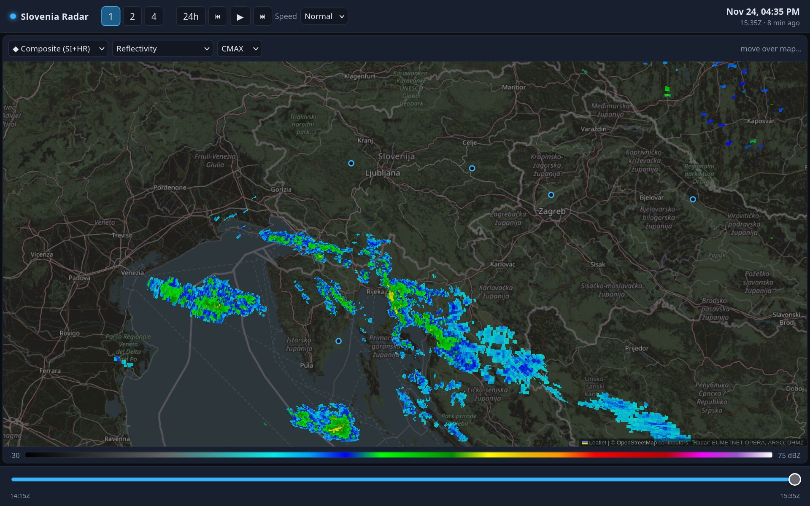
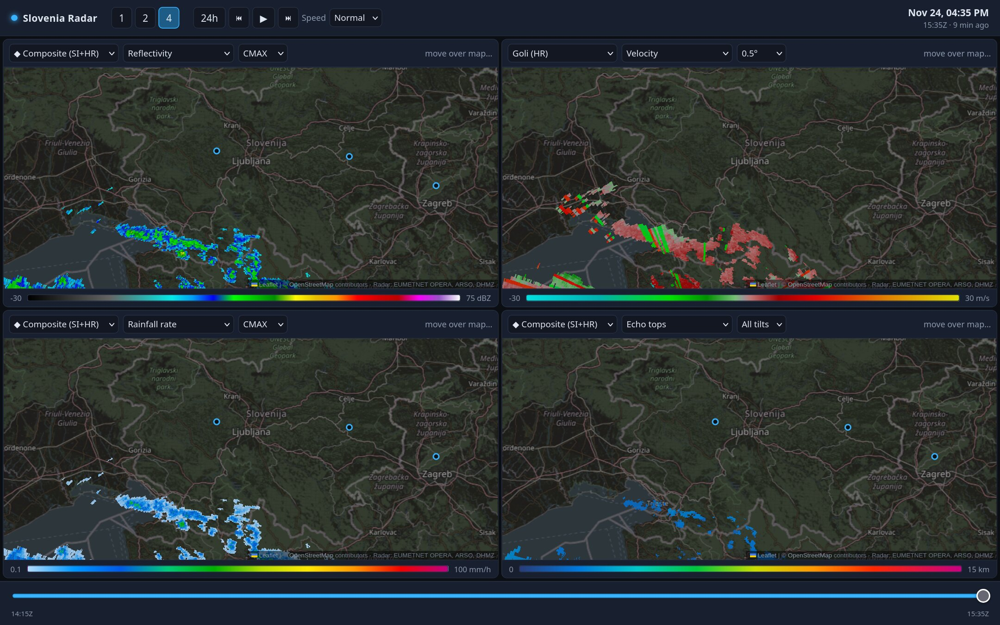
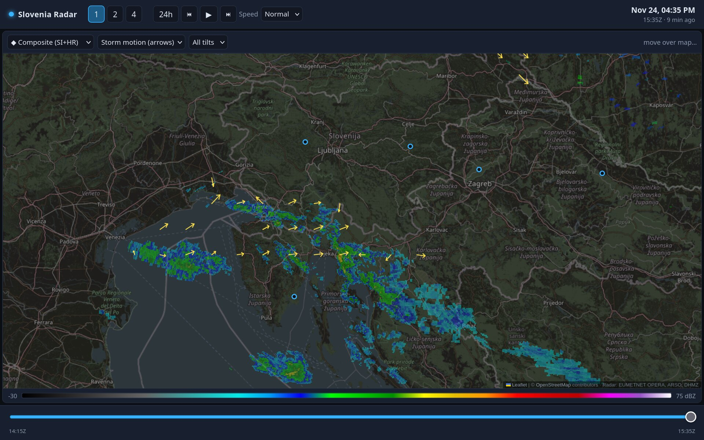
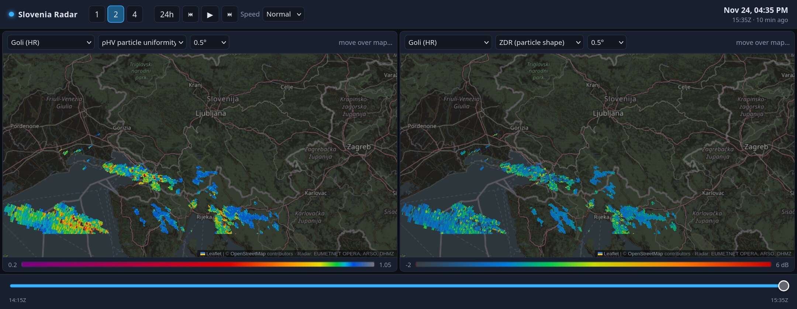
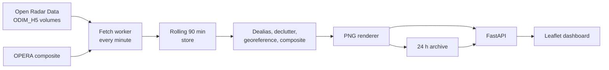

# Slovenia Weather Radar

A self-hosted, live weather-radar dashboard for Slovenia and its surroundings.
It downloads **raw polar radar volumes** (ODIM_H5) from EUMETNET's Open Radar
Data service and turns them into map products itself, instead of re-serving
ready-made radar images.

Python (NumPy) backend with optional **Rust** kernels, FastAPI, and a plain
JavaScript + Leaflet frontend. Runs in one Docker container.



## Features

- **Multi-radar composites** on a Web Mercator grid that lines up with the
  Leaflet basemap, plus every radar on its own, tilt by tilt.
- **13 products**, from reflectivity to polarimetric moments and a 30-minute
  nowcast.
- **1, 2 or 4 synced panels**, each with its own source, product and tilt.
- **Timeline playback**: the last 90 minutes of everything, and a **24-hour
  loop** of composite reflectivity, pre-rendered as each new frame arrives.
- **Hover inspector** with the value, beam height and source radar under the
  cursor.
- **Keeps going when a source drops out**: the timeline follows whichever radar
  has data, downloads fall back to EUMETNET's backup bucket, and the OPERA
  European composite fills in reflectivity.
- **Safe on a shared server**: capped memory and CPU, limited render
  concurrency. Open pages reload themselves after a deploy.

## Screenshots

**Four synced panels**: reflectivity, radial velocity, rainfall rate, echo tops



**Storm motion** from block matching of successive reflectivity frames



**Polarimetric moments** (ρHV and ZDR) from the Croatian radar Goli



## Products

| Product | Source | Notes |
|---|---|---|
| Reflectivity | all tilts or one | column maximum (CMAX) or a single elevation |
| Rainfall rate | reflectivity | Marshall-Palmer Z-R, hail-capped at 53 dBZ |
| Total power | all tilts or one | reflectivity before clutter correction |
| Echo tops | all tilts | highest beam with at least 18 dBZ |
| VIL | all tilts | vertically integrated liquid, capped at 56 dBZ |
| Velocity | one tilt | dealiased along each ray; nearest radar in composites |
| Azimuthal shear | velocity | highlights rotation |
| ρHV, ZDR | one tilt | Croatian radars only |
| Storm motion | two CMAX frames | block-matching vectors |
| Nowcast +30 min | CMAX and motion | moves the current echo along the median motion |
| Rain accumulation 1 h | rainfall rate | sum over the last hour |
| Dual-Doppler wind | two radars | needs overlapping velocity from both |

Reflectivity, rainfall rate and total power cover a wide area (44.4–48.2°N,
11.6–18.0°E). The other products use a smaller grid centred on Slovenia
(45.2–47.0°N, 12.4–16.8°E).

## Data sources and current coverage

As of November 2026:

| Radar | Country | Raw volumes in the feed |
|---|---|---|
| Goli (`hrgol`) | HR | yes |
| Bilogora (`hrbil`) | HR | yes |
| Puntijarka (`hrpun`) | HR | no |
| Lisca (`silis`) | SI | no |
| Pasja Ravan (`sipas`) | SI | no |

The missing radars are still configured and return automatically if they are
published again. Until then:

- Over most of Slovenia, reflectivity and rainfall rate come from the **OPERA
  composite** (1 km, every 5 minutes), which still includes both Slovenian
  radars. It is used only where our own radars show no echo, because it reads
  several dBZ higher than they do.
- Velocity, echo tops, VIL and the polarimetric products need raw volumes, so
  they only exist within reach of the two Croatian radars.
- Dual-Doppler wind has no suitable radar pair and shows "No data".

## Quick start

```bash
git clone https://github.com/MrCloudy2/weather-radar.git
```

```bash
cd weather-radar && docker compose up -d --build
```

Open <http://localhost:8099>. The first frames appear after a minute or so of
backfilling. No API key is needed.

To serve it under a subpath, set `RADAR_ROOT_PATH=/radar` (already in
[docker-compose.yml](docker-compose.yml)) and proxy to the container with the
trailing slash:

```nginx
location /radar/ { proxy_pass http://127.0.0.1:8099/; }
```

### Without Docker

```bash
python -m venv .venv && .venv/bin/pip install -r requirements.txt
```

```bash
.venv/bin/uvicorn radar.api:app --port 8099
```

With a Rust toolchain, `sh native/build.sh` builds the faster kernels. Without
them the app runs on NumPy alone.

## How it works



Gates are placed with the standard 4/3-effective-earth beam model. Each output
pixel looks up its own ray and range bin, so there are no gaps between gates.
Only raw data is cached on disk; products are rendered on request, except the
composite reflectivity that feeds the 24-hour archive.

### Rust kernels

Measured with `scripts/bench_native.py` on an Intel i9-11900 (best of several
runs, four radars from July 2026):

| Product | NumPy | Rust | Speedup |
|---|--:|--:|--:|
| VIL | 1123 ms | 63 ms | 17.8× |
| Reflectivity CMAX composite | 1242 ms | 413 ms | 3.0× |
| Echo tops | 706 ms | 59 ms | 12.0× |
| Velocity mosaic | 481 ms | 69 ms | 7.0× |
| Dual-Doppler wind | 349 ms | 38 ms | 9.3× |
| Dealiasing, one sweep | 9.4 ms | 0.2 ms | 46.5× |

The benchmark also compares outputs. Echo tops, VIL and the velocity mosaic may
differ in up to 0.005 % of pixels, because the fast path reuses one sweep's ray
angles for all sweeps of a radar. Storm motion is not listed: the test frames
hold too little echo to measure it.

## API

| Endpoint | Returns |
|---|---|
| `/api/sources` | radars, their products and the grid bounds |
| `/api/timeline` | live frame list (`?node=` for a specific radar) |
| `/api/archive` | frames in the 24-hour reflectivity archive |
| `/api/tile.png` | rendered overlay: `quantity`, `time`, `node` or `nodes`, `sweep`, `cmax` |
| `/api/value` | value at a point: as above plus `lat`, `lon` |
| `/api/legend` | colour scale for a `quantity` |
| `/api/motion` | storm-motion vectors |
| `/api/windvectors` | dual-Doppler wind vectors |
| `/api/version` | build hash, used for auto-reload |

## Project layout

| Path | Contents |
|---|---|
| `radar/fetcher.py`, `radar/opera.py` | downloads of radar volumes and the OPERA composite |
| `radar/odim.py`, `radar/geo.py` | ODIM_H5 reading, beam and map geometry |
| `radar/process.py`, `radar/render.py` | dealiasing and declutter, gridding and PNG output |
| `radar/composite.py`, `radar/analysis.py` | multi-radar mosaics, motion, nowcast, winds |
| `radar/store.py`, `radar/api.py` | worker, caches and archive, FastAPI app |
| `radar/static/` | Leaflet frontend |
| `native/` | Rust kernels |
| `scripts/` | benchmark and manual validation tools |

## Limitations

- Dealiasing works along one ray at a time, so strongly folded velocity can
  leave wrong-signed streaks.
- Rainfall rate uses one fixed Z-R relation and is not gauge-corrected.
- The nowcast only shifts existing echo; it does not grow or decay storms.
- This is a hobby project. For warnings and safety decisions use
  [ARSO](https://meteo.arso.gov.si) or [DHMZ](https://meteo.hr).

## Credits

Radar data: [EUMETNET OPERA / Open Radar Data](https://eumetnet.github.io/openradardata-documentation/),
ARSO and DHMZ. Basemap © [OpenStreetMap](https://www.openstreetmap.org/copyright)
contributors, drawn with [Leaflet](https://leafletjs.com).
